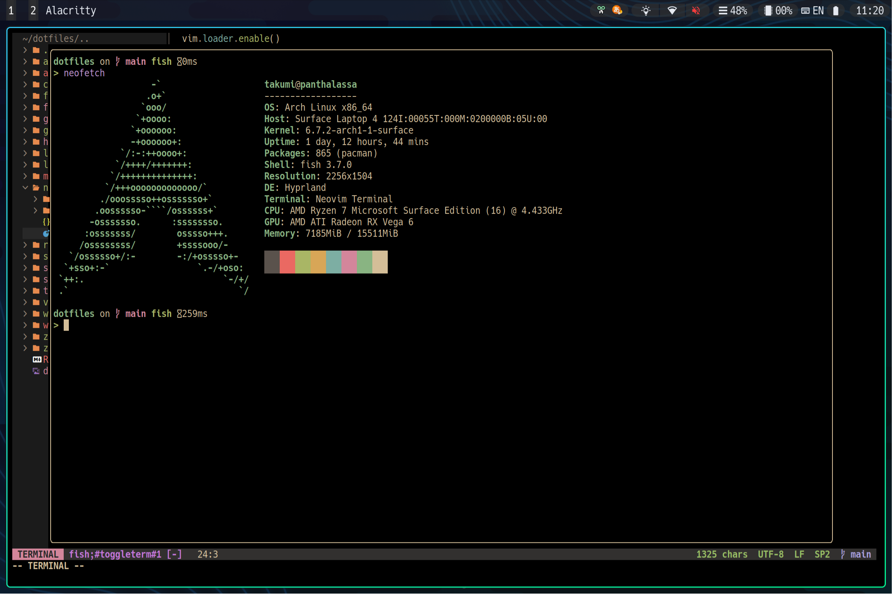

# Dotfiles

A collection of dotfiles, managed with [Nix](https://nixos.org/) flakes and [Home Manager](https://github.com/nix-community/home-manager) (standalone).



# Setup (Arch Linux / WSL)

## 1. Install Nix

Use the `nix` package from pacman, with the daemon.

```sh
sudo pacman -S nix
echo 'experimental-features = nix-command flakes' | sudo tee -a /etc/nix/nix.conf
sudo systemctl enable --now nix-daemon.socket
```

## 2. Apply the configuration

```sh
git clone (path_to_this_repo) ~/dotfiles
cd ~/dotfiles

# First time: home-manager is not installed yet.
# -b backup renames existing files (e.g. ~/.bashrc -> ~/.bashrc.backup).
nix run home-manager -- switch -b backup --flake .#takumi

# After that
home-manager switch --flake ~/dotfiles#takumi
```

Set bash as the login shell; it switches to fish for interactive use (see `home-manager/bash.nix`).

```sh
chsh -s /usr/bin/bash
```

# Layout

| Path                      | Contents                                                         |
| ------------------------- | ---------------------------------------------------------------- |
| `flake.nix`               | Entry point (`homeConfigurations.takumi`)                        |
| `home-manager/home.nix`   | Common settings, CLI packages, list of modules                   |
| `home-manager/<name>/`    | Module with its own config files (e.g. `hypr`, `waybar`, `nvim`) |
| `home-manager/<name>.nix` | Module written only in Nix (e.g. `git.nix`, `gtk.nix`)           |
| `vim/`                    | Still managed with GNU stow (`stow -v vim`)                      |

`conf <name>` opens the configuration of a tool in nvim.

# Notes

- GUI apps (Hyprland, waybar, foot, mako, zathura, ...) are installed with pacman.
  Home Manager manages only their config files, because Nix GUI apps can't find
  the GL drivers outside NixOS.
- Files are copied into `/nix/store`, so edits take effect after `home-manager switch`.
  Exception: `nvim` is linked directly to this repository.
- New files must be `git add`ed before switching; flakes ignore untracked files.
